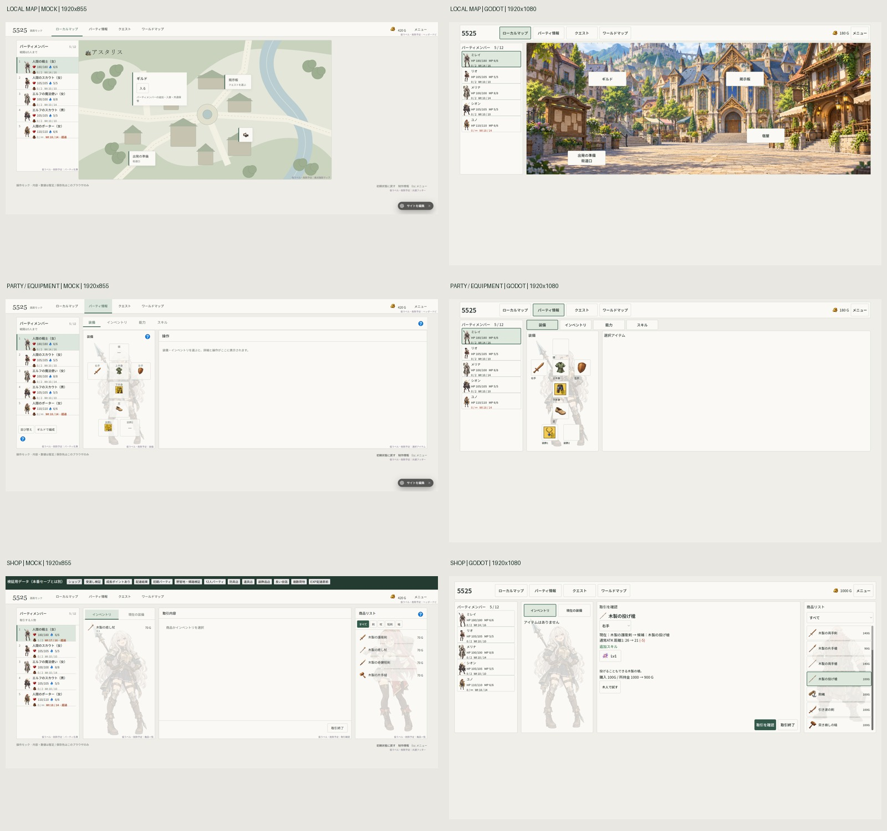

# モックUIのゲーム移植 — 2026-11-06

## 対象と状態

- 作業フォルダ: `G:/Apps/CodexProjects/5525/5525-UI-Improvement`
- ブランチ: `ui/mock-ui-migration`
- mainの開始点: `7280d622da7702097135216df255b3548b0029dc`
- ローカルブランチで実装を保存。push / mainへのmergeは未実施。
- 承認済みモックの配置・操作整理をGodotへ移植。戦闘をブラウザモックの簡略表現へ置換する作業ではない。FHD対象。
- ユーザー追加承認: RP報酬と、通った経路を時間・戦闘付きで戻るゲーム処理も追加。

## 実画面の比較

左は2026-11-06に取得したブラウザの実画面、右はGodot実行画面。元画像はブラウザ1920×855、ゲーム1920×1080。画像の縦横比を保持して並べており、ピクセル一致を示す比較ではない。ゲーム側の街背景、キャラクター名・素材、価格・能力値を保持している。モックの検証バーや仮ラベルはゲームへ移植しない。

比較元: 親フォルダ `mock-migration-{town,party,shop}.png`、ゲーム `godot/qa/mock-town.png`、`godot/qa/mock-character-final.png`、`.qa-shop-captures/shop-comparison.png`。街は12:40、パーティは12:46、ショップは12:32の撮影。画像はその時点の証拠であり、その後の全変更を撮影したものではない。

## 移植内容

| 場面 | 変更内容 |
| --- | --- |
| 共通 | 明るい背景と緑の操作色、ローカルマップ／パーティ情報／クエスト／ワールドマップ。共通名簿と作業領域の配置を統一。 |
| パーティ情報 | 装備／インベントリ／能力／スキルを分離。身体に沿った装備枠、固定した詳細領域、装備比較、受け渡しとその結果表示。 |
| 店舗 | 名簿・個人インベントリ・取引詳細・商品リスト。人物を薄く背面表示し、装備タブと商品種類絞り込み、下部の取引終了を配置。 |
| 施設入口 | 選択肢を左、NPCを中央、会話を右へ。下端の店を出る。ギルドは編成と倉庫を直接選択。 |
| ギルド | 現メンバーと候補を中央で比較、控えを右へ。追加と入替を明示。 |
| 倉庫 | 個人インベントリ・選択アイテム・共通倉庫。複数個移動の個数ダイアログを簡潔化。 |
| 宿屋 | 回復前後と費用を表示。休息するの右に戻る。 |
| クエスト | 広い一覧、詳細、依頼人画像。荷物アイコン×数量と合計Wt。基本／条件達成報酬、RPとキャラクターEXPを区別。 |
| ワールドマップ・道中 | 名簿を左へ。行先・出発・クエスト確認を地図側へ集約。道中は横一本道、全体地図は表示専用。引き返す操作を実ゲーム処理へ接続。 |
| 勝利・報酬 | レベルアップしたメンバーだけを画像と前後レベルで表示。詳細を折りたたみ、終了ボタンをOKへ。 |

報酬・帰路・旧セーブ互換・直接装備受け渡しの詳細は [native/UI-MIGRATION-RULES.md](../native/UI-MIGRATION-RULES.md)。150の報酬は基本97＋追加53。EXPは達成時の同行メンバーそれぞれに同額、RPは独立保存。ランク曲線は未確定なので創作していない。

## 検証済み範囲

| 検証 | 結果と限界 |
| --- | --- |
| 起動確認 | `Start-5525.cmd -Check` / `-SmokeTest` 通過。Godot4.6.3。 |
| 新規ネイティブルール | `test_mock_ui_rules.cjs` 12/12。報酬、旧セーブ、帰路、無効操作等。 |
| 既存ネイティブ回帰 | campaign47、quest_cargo15、standalone8群、ui_feedback8群通過。 |
| パーティUI | `mock_character_migration.gd` 19/19、ヘッドレスと実描画。 |
| ショップUI | `mock_shop_migration.gd` 25/25。 |
| 施設UI | `mock_facility_migration.gd` 14/14ヘッドレス。実描画は追加前の11項目通過＋撮影。実入替・倉庫2個入庫/1個出庫を含む。 |
| 移動UI | `mock_travel_regression.gd` 9/9。 |
| 統合移動フロー | `mock_journey_integration.gd` 15/15、最終統合後の再実行も通過。戦闘勝利境界はfixtureで、戦術プレイ完走の証明ではない。 |

## 未解決・検証限界

- 全テスト成功とはしていない。従来frontend_smokeは34/36。削除済みBGM曲名ラベルへの古い期待値と、Dummy音声環境の再生状態確認が残る。後者は原因未確定。実機で音声を聴いた検証ではない。
- native/check.pyのPythonは212/213。旧旅fixtureの `enemy-scout-2` 不在によるStopIterationは、開始点のcampaign/bridgeを使った隔離環境でも再現。今回導入の失敗とは判定していない。
- すべてのNPC台詞長、全アイテムの組合せ、全都市の全施設、長期セーブでの連続実プレイは網羅していない。
- FHD以外は対象外。モックとのピクセル一致は要求・検証していない。
- ゲーム画面には1080px全高を埋めない余白がある。作業領域と操作位置の固定を優先した現状で、余白を埋めるための補足情報は追加していない。
- `godot/qa`等の実行生成物や隔離プロファイルは実装ソースと区別し、無差別にcommitしない。
